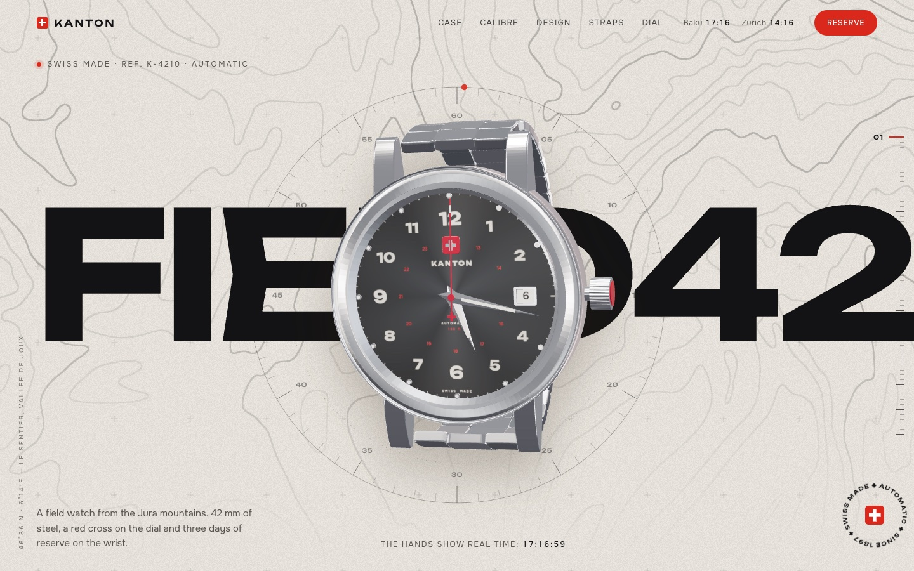
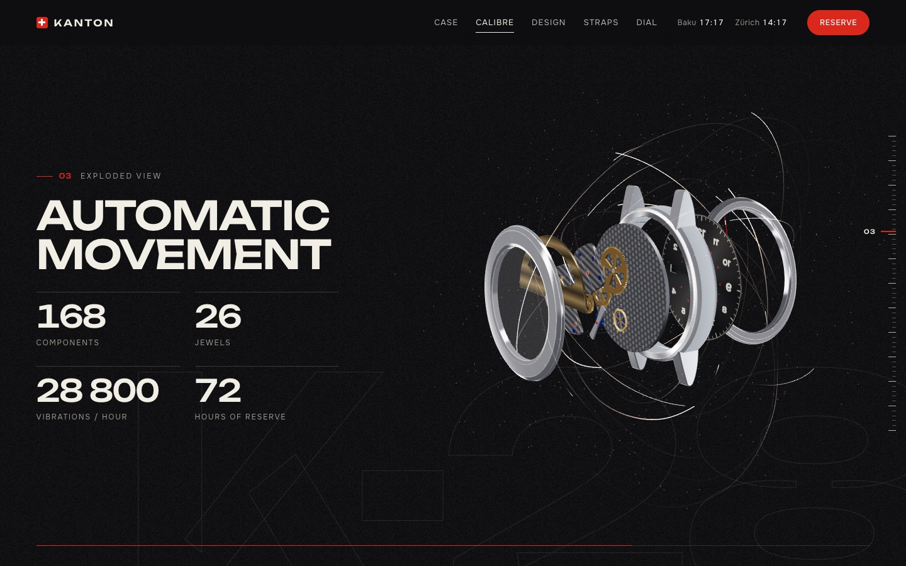

# ⌚ KANTON Field 42 — Swiss Watch Website

A concept website for a fictional Swiss field watch. The watch is a 3D model built entirely in code: it turns, opens up and changes straps as you scroll.

**[Live demo →](https://boss-ui24.github.io/swiss-watch-3d/)**





## Features

- **3D watch:** a procedural model with a red cross on the dial, real-time hands and a moving seconds hand
- **Scroll choreography:** each section has its own pose, and the watch glides between them
- **Exploded movement:** the case opens and the automatic calibre comes apart layer by layer
- **Strap change:** scroll to unwind one strap and wind on the next: steel, leather, NATO and rubber
- **Dial configurator:** pick the dial and strap and see the watch update live
- **Marble backgrounds:** white and black stone generated by a shader, no images
- **Details:** marquees that speed up with the scroll, Swiss Made seals, a scale ring around the watch, callouts to the crown and lugs, a topographic map of the Jura, paper grain and a custom cursor
- **Responsive design:** works on desktop and phones

## Built with

- [Three.js](https://threejs.org/) — 3D scene, the watch is modelled in code
- [GSAP](https://gsap.com/) — ScrollTrigger, SplitText, ScrollToPlugin
- [Lenis](https://lenis.darkroom.engineering/) — smooth scrolling
- Plain HTML, CSS and JavaScript, no build step

## Run locally

```bash
git clone https://github.com/boss-ui24/swiss-watch-3d.git
cd swiss-watch-3d
python3 -m http.server 8000
```

Then open http://localhost:8000. An internet connection is required because the libraries load from a CDN.

## Project structure

```text
├── index.html       page markup and section poses
├── css/style.css    styles
├── docs/            screenshots for this README
└── js/
    ├── app.js       preloader, scrolling, text animations, configurator
    ├── scene.js     3D scene and watch poses per section
    ├── watch.js     procedural watch model and movement
    ├── stone.js     procedural marble backgrounds
    └── decor.js     marquees, seals, callouts, cursor
```

---

This is a demo project: KANTON and its watches are fictional and not related to any real brand.
